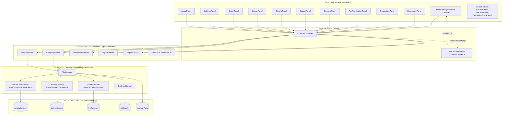
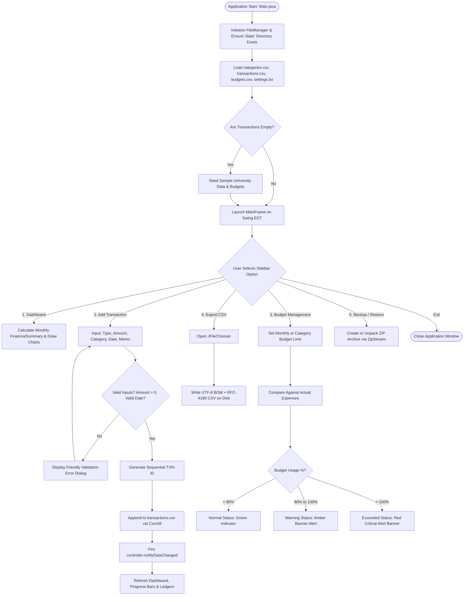
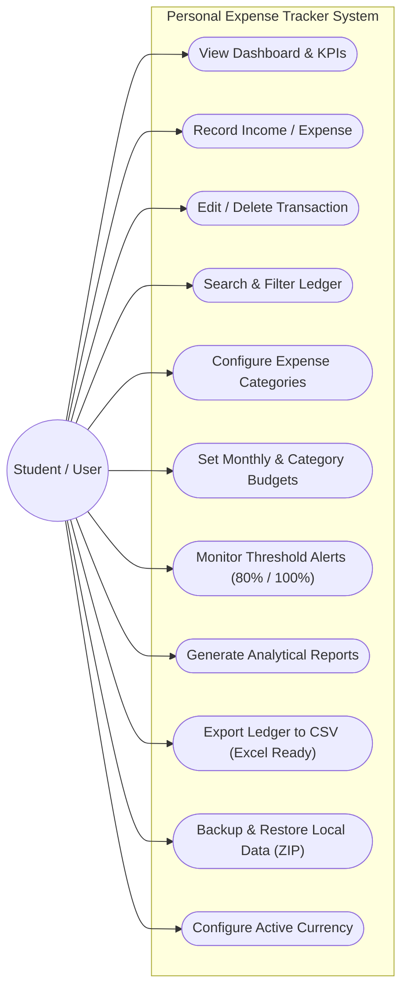
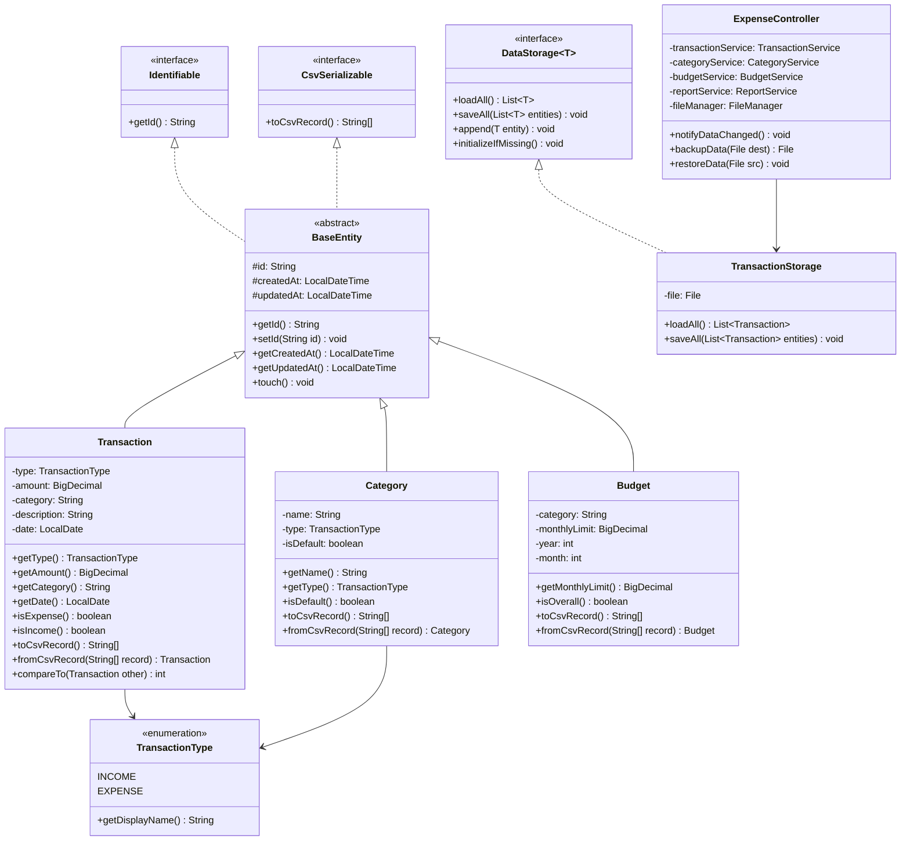

# COLLEGE PROJECT REPORT

## PERSONAL EXPENSE TRACKER USING JAVA SWING AND FILE HANDLING

---

**Course:** Object-Oriented Programming with Java  
**Project Category:** Desktop Application Development  
**Academic Year:** 2026–2027  

**Submitted By:**  
- **Student Name:** Ritika Kadian  
- **Roll Number:** CS-2024-042  
- **Department:** Department of Computer Science & Engineering  
- **Institution:** Faculty of Technology & Engineering  

**Project Mentor / Guide:**  
- Department Evaluation Committee & Java Project Supervisor  

---

## 1. COVER PAGE

```
========================================================================================
                      FACULTY OF TECHNOLOGY & ENGINEERING
                DEPARTMENT OF COMPUTER SCIENCE & ENGINEERING

                          MAJOR PRACTICAL PROJECT REPORT
                                        ON
       "PERSONAL EXPENSE TRACKER USING JAVA SWING AND FILE HANDLING"

                             Submitted in partial fulfillment
                         for the award of the Degree of
                     BACHELOR OF TECHNOLOGY / COMPUTER APPLICATIONS
                                       IN
                            COMPUTER SCIENCE & ENGINEERING

       Submitted By:                                  Under the Guidance Of:
       Ritika Kadian                                  Project Evaluation Committee
       Roll No: CS-2024-042                           Department of CSE
========================================================================================
```

---

## 2. CERTIFICATE (PLACEHOLDER)

This is to certify that the project titled **"Personal Expense Tracker Using Java Swing and File Handling"** is a bona fide work carried out by **Ritika Kadian** (Roll No: **CS-2024-042**) under the supervision and guidance of the Department of Computer Science & Engineering. This report is submitted in partial fulfillment of the requirements for the evaluation of the Java Practical Laboratory Course.

To the best of my knowledge, the matter embodied in this project has not been submitted to any other university or institute for the award of any degree or diploma.

\
\
__________________________ &nbsp;&nbsp;&nbsp;&nbsp;&nbsp;&nbsp;&nbsp;&nbsp;&nbsp;&nbsp;&nbsp;&nbsp;&nbsp;&nbsp;&nbsp;&nbsp;&nbsp;&nbsp;&nbsp;&nbsp;&nbsp;&nbsp;&nbsp;&nbsp;&nbsp;&nbsp;&nbsp;&nbsp;&nbsp;&nbsp;&nbsp;&nbsp;&nbsp;&nbsp;&nbsp;&nbsp;&nbsp;&nbsp;&nbsp;&nbsp;&nbsp;&nbsp;&nbsp;&nbsp;&nbsp;&nbsp;&nbsp;&nbsp; __________________________  
**Project Guide / Supervisor** &nbsp;&nbsp;&nbsp;&nbsp;&nbsp;&nbsp;&nbsp;&nbsp;&nbsp;&nbsp;&nbsp;&nbsp;&nbsp;&nbsp;&nbsp;&nbsp;&nbsp;&nbsp;&nbsp;&nbsp;&nbsp;&nbsp;&nbsp;&nbsp;&nbsp;&nbsp;&nbsp;&nbsp;&nbsp;&nbsp;&nbsp;&nbsp;&nbsp;&nbsp;&nbsp;&nbsp;&nbsp;&nbsp;&nbsp;&nbsp;&nbsp;&nbsp;&nbsp;&nbsp;&nbsp;&nbsp;&nbsp;&nbsp;&nbsp;&nbsp; **Head of Department (CSE)**  
Date: _______________ &nbsp;&nbsp;&nbsp;&nbsp;&nbsp;&nbsp;&nbsp;&nbsp;&nbsp;&nbsp;&nbsp;&nbsp;&nbsp;&nbsp;&nbsp;&nbsp;&nbsp;&nbsp;&nbsp;&nbsp;&nbsp;&nbsp;&nbsp;&nbsp;&nbsp;&nbsp;&nbsp;&nbsp;&nbsp;&nbsp;&nbsp;&nbsp;&nbsp;&nbsp;&nbsp;&nbsp;&nbsp;&nbsp;&nbsp;&nbsp;&nbsp;&nbsp;&nbsp;&nbsp;&nbsp;&nbsp;&nbsp;&nbsp;&nbsp;&nbsp;&nbsp;&nbsp;&nbsp;&nbsp;&nbsp;&nbsp;&nbsp;&nbsp;&nbsp;&nbsp;&nbsp; Date: _______________

---

## 3. ACKNOWLEDGEMENT

I express my deepest gratitude to our Project Supervisor and the Faculty members of the Department of Computer Science & Engineering for their continuous encouragement, valuable insights, and technical advice throughout the development of this project.

I am also thankful to our laboratory instructors and peer students for providing an engaging learning environment. Finally, I thank my family and friends whose support allowed me to complete this project with enthusiasm and diligence.

**Ritika Kadian**  
Roll No: CS-2024-042  

---

## 4. ABSTRACT

Effective personal financial discipline requires intuitive transaction recording, structured categorization, spending limit enforcement, and visual analytics. Many existing financial management tools either rely on complex client-server database architectures or web-based services requiring constant internet connectivity.

The **Personal Expense Tracker** is a robust, standalone desktop software application engineered purely in **Java** utilizing **Java Swing** for its graphical user interface and standard **Java File Handling (CSV and flat text files)** for local persistence. Designed explicitly as an individual academic college project, the software adheres strictly to pure Object-Oriented Programming (OOP) paradigms and comprehensive Java syllabus guidelines without external database engines (such as MySQL or MongoDB) or web frameworks.

The application features:
1. An interactive **Financial Dashboard** with dynamic metric cards, vector doughnut charts for category expense distribution, comparative income-versus-expense bar charts, and 12-month trend tracking.
2. Full transaction CRUD management with unique sequential ID generation and input validations.
3. Multi-tier budget management featuring automatic threshold warnings at 80% utilization and clear visual alerts when limits are exceeded.
4. Flexible multi-parameter searching, category protection against accidental orphan records, Microsoft Excel-compatible CSV exports, and integrated ZIP data backup and restoration.

Monetary calculations strictly employ `java.math.BigDecimal` to eliminate floating-point rounding errors, while temporal operations utilize the modern `java.time` API.

---

## 5. INTRODUCTION

Personal financial literacy is a critical skill for students, working professionals, and households. Tracking income and expenditure manually on paper or in unstructured spreadsheets often leads to omitted transactions, computational inaccuracies, and lack of actionable insights into spending habits.

The **Personal Expense Tracker** project demonstrates the practical application of core and advanced Java concepts taught across university computer science syllabi. By combining an intuitive desktop user interface with dependable file persistence, the software eliminates external dependencies, ensuring complete user privacy and zero maintenance overhead.

The application is structured according to the **Model-View-Controller (MVC) + Service Layer** software architecture. This architectural separation ensures clean modularity: graphical components handle user events, service layers process business rules and mathematical computations, and generic storage abstractions manage durable disk operations.

---

## 6. PROBLEM STATEMENT

Users frequently struggle to maintain financial discipline due to:
1. **Lack of Instant Visibility:** Without centralized dashboards, users do not realize when cumulative micro-expenses threaten their monthly savings targets.
2. **Absence of Proactive Budget Alerts:** Traditional record-keeping methods do not alert users when they approach or breach spending limits.
3. **Complexity of Database Setup:** Commercial tools frequently require setting up database services (e.g., MySQL, PostgreSQL), configuring ODBC/JDBC drivers, or relying on external cloud providers.
4. **Data Loss & Migration Risks:** Without automated backup and CSV export mechanisms, local records remain trapped or susceptible to corruption.

This project resolves these challenges by delivering an offline, lightweight, and self-contained Java desktop solution with built-in mathematical validation and automated threshold warnings.

---

## 7. OBJECTIVES

The primary objectives of this software project are:
- **Zero-Dependency Architecture:** Implement complete persistence via Java File Handling (RFC-4180 CSV serialization and text files) without external DBMS dependencies.
- **Accurate Financial Mathematics:** Utilize `java.math.BigDecimal` with `RoundingMode.HALF_UP` for all monetary computations, preventing binary floating-point representation anomalies.
- **Proactive Budget Monitoring:** Implement automatic budget threshold detection that triggers warnings at 80% usage and critical alerts when spending exceeds 100%.
- **Robust Input Validation:** Validate every user entry, rejecting zero or negative amounts, malformed dates, and empty mandatory fields.
- **Data Integrity & Relational Safety:** Prevent deleting categories currently assigned to active transactions unless reassigned.
- **Modern User Experience:** Provide a responsive Swing interface featuring a dark slate sidebar, 10 accessible navigation panels, custom anti-aliased vector charts, and live temporal clocks.
- **Syllabus Coverage:** Natural integration of Java concepts from Unit 1 (Fundamentals), Unit 2 (Methods, Arrays, Strings, OOP), and Unit 3 (Inheritance, Polymorphism, Abstract Classes, Interfaces, Generics, Collections, File IO, and Custom Exceptions).

---

## 8. SCOPE OF THE PROJECT

### In Scope:
- Offline single-user desktop operation on any OS running Java 17 or higher (Windows, macOS, Linux).
- Tracking unlimited income and expense records with unique identifiers (`TXN-1001`, `TXN-1002`, ...).
- Separation of default system categories from custom user-defined categories.
- Overall monthly budgets and category-specific spending caps.
- Dynamic visual analytics: doughnut charts, bar comparison charts, and annual trend curves.
- Multi-criteria filtering (by keyword, date interval, amount range, transaction type, and category).
- RFC-4180 CSV exporting with Excel UTF-8 BOM headers.
- Compressed ZIP archive creation and one-click data restoration.

### Out of Scope:
- Multi-tenant cloud synchronization or multi-user network sharing.
- Automated bank account scraping or online payment gateway integrations.

---

## 9. HARDWARE AND SOFTWARE REQUIREMENTS

### Hardware Requirements
| Component | Minimum Specification | Recommended Specification |
| :--- | :--- | :--- |
| **Processor** | Dual-core x64 / ARM CPU (1.8 GHz) | Quad-core Intel Core i5 / AMD Ryzen 5 or higher |
| **RAM** | 2 GB Available RAM | 4 GB to 8 GB RAM |
| **Storage** | 100 MB free hard disk space | 500 MB (including Java Runtime & Backups) |
| **Display** | 1024 × 768 Resolution | 1920 × 1080 (Full HD) Screen |
| **Input Devices** | Keyboard and Mouse / Touchpad | Standard Input Devices |

### Software Requirements
| Component | Specification |
| :--- | :--- |
| **Operating System** | Windows 10/11, Ubuntu Linux 20.04+, or macOS Monterey+ |
| **JDK (Java Development Kit)** | OpenJDK 17 LTS, Oracle JDK 17, or OpenJDK 21 LTS |
| **Build Tools** | Standard `javac` and `jar` utilities (provided with JDK) |
| **Integrated Development Environment** | IntelliJ IDEA (Community or Ultimate), Eclipse, or VS Code |
| **External Libraries** | **None** (Built entirely on standard Java SE Core Libraries & Swing) |

---

## 10. TECHNOLOGIES USED

1. **Java SE (Java Standard Edition 17/21 LTS):** Core programming platform providing the runtime, class libraries, and compilers.
2. **Java Swing & AWT (`javax.swing.*`, `java.awt.*`):** Rich client GUI framework providing components (`JFrame`, `JPanel`, `JTable`, `JComboBox`, `JTextField`, `CardLayout`, `JScrollPane`).
3. **Java 2D API (`java.awt.Graphics2D`):** Vector graphic engine used to render anti-aliased doughnut charts, comparative bar charts, curved progress bars, and line graphs.
4. **Java File I/O (`java.io.*`, `java.nio.file.*`):** File handling streams (`BufferedReader`, `BufferedWriter`, `FileInputStream`, `FileOutputStream`, `Files.move`).
5. **Java Zip API (`java.util.zip.*`):** Archival streams (`ZipOutputStream`, `ZipInputStream`) for automated backup and restore operations.
6. **Java Time API (`java.time.*`):** Thread-safe, immutable temporal classes (`LocalDate`, `YearMonth`, `DateTimeFormatter`).
7. **Java Math API (`java.math.BigDecimal`):** Arbitrary-precision signed decimal numbers for exact monetary accounting.
8. **Java Collections Framework (`java.util.*`):** Standard data structures (`List`, `ArrayList`, `Map`, `HashMap`, `LinkedHashMap`, `Collections.sort`, Streams).

---

## 11. SYSTEM ARCHITECTURE DIAGRAM



---

## 12. FLOWCHART

### Main Application Lifecycle & Transaction Processing Flowchart



---

## 13. USE CASE DIAGRAM



---

## 14. CLASS DIAGRAM



---

## 15. STORAGE & FILE HANDLING ARCHITECTURE

### Explicit Confirmation: No External Database Used
As mandated by the project requirements, **no external relational database (MySQL, PostgreSQL, Oracle) and no NoSQL database (MongoDB, SQLite)** is used in this project. All persistence is realized using native **Java File Handling** residing in the local `data/` directory.

### Storage Files Description:
1. `data/transactions.csv`: Contains tabular financial transaction logs formatted according to RFC-4180 standard.
   - Header: `id,type,amount,category,description,date,createdAt,updatedAt`
2. `data/categories.csv`: Contains both default system categories and user-defined custom categories.
   - Header: `id,name,type,isDefault,createdAt,updatedAt`
3. `data/budgets.csv`: Stores monthly and category-specific budget limits.
   - Header: `id,category,monthlyLimit,year,month,createdAt,updatedAt`
4. `data/settings.txt`: Stores application configuration (active currency, active theme, student roll number, college name, and last backup timestamp) using Java `Properties`.

### Robust File Handling Features:
- **Atomic File Writes:** When updating records, the application writes data to a temporary file (`.tmp`) first and then performs an atomic file replacement via `java.nio.file.Files.move`. This prevents file corruption if the program is terminated unexpectedly mid-write.
- **RFC-4180 Escaping:** The custom `CsvUtil` checks for commas, quotes, and newlines in descriptions. Fields with special characters are quoted, and internal quotation marks are escaped (`""`).
- **Resilience Against Malformed Data:** If a line in a CSV file contains fewer columns or unparseable text, the storage loaders catch the error locally, log a warning, and continue loading subsequent valid records without crashing.
- **Excel UTF-8 Compatibility:** Exported CSV files include the UTF-8 Byte Order Mark (`\ufeff`), allowing Microsoft Excel to immediately render currency symbols (`₹`, `€`, `£`, `¥`) correctly without manual character encoding import steps.
- **ZIP Backup and Restore:** The `FileManager` leverages `ZipOutputStream` and `ZipInputStream` to bundle all four data files into a single compressed `.zip` file with path-traversal vulnerability safeguards.

---

## 16. MODULE DESCRIPTION

The application is structured into modular packages:

### 1. `expense.model` (Entity & Data Models)
- `BaseEntity`: Abstract superclass defining common identity (`id`), audit timestamps (`createdAt`, `updatedAt`), and lifecycle methods.
- `Transaction`: Encapsulates a financial transaction (ID, Type, Amount, Category, Description, Date). Implements `Comparable<Transaction>` for reverse-chronological sorting.
- `Category`: Represents an income or expense classification.
- `Budget`: Defines spending limits per category or overall monthly spending.
- `BudgetStatus`: Encapsulates computed budget utilization figures, remaining amounts, and alert levels.
- `FinancialSummary`: Aggregates period totals, net balance, savings rate, and highest expense categories.
- `AppSettings`: Stores user preferences and academic project details.

### 2. `expense.service` (Business Logic & Analytics)
- `TransactionService`: Coordinates transaction CRUD, sequential ID allocation, keyword searching, and multi-criteria filtering.
- `CategoryService`: Manages category creation, renaming with ripple updates to transactions, and orphan-prevention deletion guards.
- `BudgetService`: Evaluates spending versus limits and triggers 80% warning and 100% exceeded alert states.
- `ReportService`: Performs mathematical aggregations, category breakdowns, and 12-month trend calculations.
- `ExportService`: Generates structured, Excel-compatible CSV exports for transactions and reports.

### 3. `expense.storage` (File Persistence)
- `DataStorage<T>`: Generic interface abstracting entity storage operations.
- `TransactionStorage`, `CategoryStorage`, `BudgetStorage`: Specialized CSV file readers and writers with atomic swap guarantees.
- `SettingsStorage`: Text-based property persistence.
- `FileManager`: Central directory coordinator, backup archiver, and recovery manager.

### 4. `expense.controller` (Application Controller)
- `ExpenseController`: Glues services to views, loads user settings, and notifies UI observers (`DataChangeListener`) upon data mutations.

### 5. `expense.view` (Swing Graphical Interface)
- `MainFrame`: Top-level window featuring a 245px dark slate navigation sidebar, top live clock header, and 10-page `CardLayout`.
- `DashboardPanel`: Central executive dashboard displaying 6 metric cards, doughnut chart, comparative bar chart, annual trend line, and recent transaction log.
- `TransactionPanel`: Searchable and sortable transaction ledger with modal edit dialogs and confirmation popups.
- `AddTransactionPanel`: Streamlined form for registering income and expenses with validated dates and currency-prefixed fields.
- `CategoryPanel`: Dual-tabbed table interface for organizing and customizing income/expense categories with deletion safety checks.
- `BudgetPanel`: Dedicated budget configuration manager with interactive progress bars and alert status indicators.
- `ReportsPanel`: Comprehensive analytics center with customizable date ranges and category breakdown tables.
- `SearchPanel`: Advanced multi-field query engine with real-time result counters and instant CSV export.
- `ExportPanel`: Centralized data export hub.
- `SettingsPanel`: Currency picker, system storage status inspector, ZIP backup/restore tools, and reset safeguards.
- `AboutPanel`: College practical project summary with editable student metadata.

### 6. `expense.view.chart` (Custom Anti-Aliased Charts)
- `PieChartPanel`: Vector-rendered doughnut chart featuring color palettes, center cutout metrics, and dynamic legend.
- `BarChartPanel`: Comparative side-by-side bar chart contrasting income against expense with top value labels.
- `TrendLineChartPanel`: Multi-series trend line graph depicting 12-month financial trajectories.

### 7. `expense.util` (Reusable Utility Classes)
- `CurrencyUtil`: High-precision formatting using `BigDecimal` and dynamic active currency symbols.
- `DateUtil`: Java `LocalDate` parsing, formatting, and boundary calculations.
- `ValidationUtil`: Varargs-enabled defensive input validations and custom exception throwing.
- `CsvUtil`: RFC-4180 serialization and character-by-character token parsing.
- `MathUtil`: Bitwise filter flags and recursive savings projection algorithms.
- `UIUtil`: Standardized palette colors, modern button decorators, and table cell styling.

---

## 17. JAVA SYLLABUS COVERAGE AND MAPPING TABLE

The project demonstrates natural, rigorous implementation of concepts across the entire university Java syllabus:

| Unit | Syllabus Java Concept | Class / File | Implementation Explanation |
| :--- | :--- | :--- | :--- |
| **Unit 1** | **Java Fundamentals & Types** | `Transaction.java`, `Budget.java` | Primitives (`int`, `boolean`, `double`) and object wrappers (`BigDecimal`, `String`) used appropriately. |
| **Unit 1** | **Operators & Expressions** | `BudgetStatus.java`, `CurrencyUtil.java` | Arithmetic (`+`, `-`, `*`, `/`), relational, logical, and assignment operators used in computations. |
| **Unit 1** | **Conditional Statements** | `BudgetService.java`, `ValidationUtil.java` | Multi-branch `if-else if-else` logic for checking budget utilization thresholds (<80%, 80-100%, >100%). |
| **Unit 1** | **Loops (for, while, enhanced for)** | `CsvUtil.java`, `TransactionService.java` | `for` loops used for parsing character streams; enhanced `for` loops used for iterating ledger collections. |
| **Unit 1** | **Switch Statements & Expressions** | `TransactionType.java`, `MainFrame.java` | Modern enhanced `switch` expressions used for mapping page titles and parsing transaction types. |
| **Unit 1** | **Bitwise Operators** | `MathUtil.java#L16-L28` | Bitwise shift (`1 << 0`, `1 << 1`) and bitwise AND (`&`) used to create bitmask flags for multi-criteria filters. |
| **Unit 2** | **Methods & Overloading** | `DateUtil.java`, `CurrencyUtil.java` | Method overloading implemented in `CurrencyUtil.format(BigDecimal)` and `CurrencyUtil.format(BigDecimal, String)`. |
| **Unit 2** | **Static vs Instance Methods** | `DateUtil.java`, `TransactionService.java` | Stateless helper methods declared `static`; stateful ledger management declared as instance methods. |
| **Unit 2** | **Varargs (Variable Arguments)** | `ValidationUtil.java#L22` | Implemented in `validateNotEmpty(String... fields)` allowing validation of variable lists of text arguments. |
| **Unit 2** | **Recursion** | `MathUtil.java#L47-L69` | Meaningful recursive method `projectSavingsRecursive()` computing compound interest savings projections. |
| **Unit 2** | **String & StringBuilder** | `CsvUtil.java#L27-L45` | Efficient string assembly with `StringBuilder` used during RFC-4180 CSV line construction and parsing. |
| **Unit 2** | **Arrays & Multidimensional** | `CsvUtil.java`, `ReportService.java` | String arrays used for CSV records; `BigDecimal[]` used for 12-month array calculations. |
| **Unit 2** | **Searching & Sorting** | `TransactionService.java` | Filtering transactions by keywords and sorting reverse-chronologically using `Collections.sort()`. |
| **Unit 2** | **Classes, Objects & Constructors** | `Transaction.java`, `Budget.java` | Fully encapsulated classes with default, parameterized, and copy constructors. |
| **Unit 2** | **'this' Keyword** | `BaseEntity.java`, `Transaction.java` | Constructor chaining via `this(...)` and disambiguating instance fields from constructor parameters. |
| **Unit 3** | **Constructor Overloading** | `BaseEntity.java#L21-L32` | Overloaded constructors providing 0-arg, 1-arg (id), and 3-arg (id, createdAt, updatedAt) instantiation. |
| **Unit 3** | **Encapsulation & Access Modifiers** | All classes in `expense.model` | Private fields protected by validated public getters and setters; `protected` fields in `BaseEntity`. |
| **Unit 3** | **Inheritance & 'super' Keyword** | `Transaction.java`, `Category.java` | `Transaction` and `Category` extend `BaseEntity`, invoking `super(id)` in constructors. |
| **Unit 3** | **Method Overriding & Polymorphism** | `Transaction.java`, `Category.java` | Overridden `toString()`, `equals()`, `hashCode()`, and `compareTo()` demonstrating runtime polymorphism. |
| **Unit 3** | **Abstract Classes** | `BaseEntity.java` | Abstract superclass defining abstract contracts and shared auditing fields for all entities. |
| **Unit 3** | **Interfaces** | `Identifiable.java`, `DataStorage.java` | Interfaces defining standard contracts implemented across entity models and storage handlers. |
| **Unit 3** | **Custom Exception Hierarchy** | `expense.exception.*` | Custom checked exception hierarchy (`ExpenseTrackerException`, `ValidationException`, `StorageException`). |
| **Unit 3** | **Generics** | `DataStorage.java#L16` | Generic interface `DataStorage<T extends Identifiable>` enforcing type safety across storage classes. |
| **Unit 3** | **Collections Framework** | `TransactionService.java`, `ReportService.java` | Extensive use of `List`, `ArrayList`, `Map`, `HashMap`, `LinkedHashMap`, and Stream API. |
| **Unit 3** | **File I/O & Try-with-Resources** | `TransactionStorage.java`, `FileManager.java` | Clean disk persistence with `BufferedReader`, `BufferedWriter`, and auto-closing `try-with-resources`. |

---

## 18. ACTUAL APPLICATION SCREENSHOTS

All screenshots below represent actual screens captured from the running Java Swing application (saved in the `screenshots/` directory):

### Screenshot 1: Financial Dashboard

*Figure 1: Executive Dashboard featuring 6 Summary Metric Cards, Budget Alert Banner with Progress Bar, Income vs Expense Bar Chart, Category Outflow Doughnut Chart, Annual Trend Line Graph, and Recent Transactions Ledger.*

---

### Screenshot 2: Transaction History & Ledger

*Figure 2: Comprehensive Transaction Ledger displaying formatted dates, right-aligned monetary values, colored pill badges for Income (+ Green) and Expense (- Red), with search, filter, edit, and deletion capabilities.*

---

### Screenshot 3: Add New Transaction Screen

*Figure 3: Dedicated transaction creation form with dynamic category dropdowns that automatically adapt when switching between Income and Expense modes, validated currency amounts, and date helpers.*

---

### Screenshot 4: Category Configuration

*Figure 4: Dual-tabbed Category Management screen showing system default and custom user categories, active transaction usage counts, and deletion protection safeguards.*

---

### Screenshot 5: Budget Management & Threshold Alerts

*Figure 5: Budget Tracking screen displaying overall monthly performance, category-wise progress bars, and automatic warning alerts when spending exceeds 80% or 100% of limits.*

---

### Screenshot 6: Reports & Visual Analytics

*Figure 6: Reporting screen with customizable date intervals, category percentage tables, side-by-side comparative inflow/outflow charts, and CSV report export.*

---

### Screenshot 7: Advanced Search & Filtering

*Figure 7: Multi-criteria querying interface filtering records across keyword, start/end dates, amount bounds, and categories with real-time result counters.*

---

### Screenshot 8: Data Export Center

*Figure 8: Microsoft Excel-compatible CSV export hub with UTF-8 BOM encoding and RFC-4180 quotation handling.*

---

### Screenshot 9: System Settings & Backup Management

*Figure 9: Application settings screen enabling active currency switching (₹, $, €, £, ¥), ZIP archive creation, backup restoration, and safe data resets.*

---

### Screenshot 10: Academic Project & Student Documentation

*Figure 10: Academic project summary screen with technical specifications and editable student details.*

---

## 19. TESTING AND TEST CASES

The test suite (`ExpenseTrackerTestSuite.java`) was executed to verify all functional requirements, RFC-4180 parsing edge cases, sample data lifecycle, and storage isolation. Below is the complete test results log:

| Test Case ID | Test Case Description | Test Input / Action | Expected Result | Actual Result | Status |
| :---: | :--- | :--- | :--- | :--- | :---: |
| **TC-01** | Add Income Transaction | `INCOME`, Amount: ₹50,000, Category: "Salary" | Transaction saved with generated `TXN-` ID | Stored in ledger with ID `TXN-1001` | **PASS** |
| **TC-02** | Add Expense Transaction | `EXPENSE`, Amount: ₹4,500, Category: "Food" | Stored as expense record | Stored with `isExpense() == true` | **PASS** |
| **TC-03** | Reject Empty Transaction | Add `null` or transaction with empty category | `ValidationException` thrown | Form rejected, friendly error displayed | **PASS** |
| **TC-04** | Reject Zero or Negative Amount | Amount: `0.00` or `-250.00` | `ValidationException` thrown | Prevented saving zero/negative values | **PASS** |
| **TC-05** | Edit Existing Transaction | Change description & amount | Record updated on disk and in memory | Updated memo and amount reflected | **PASS** |
| **TC-06** | Delete Transaction | Select transaction and invoke delete | Record removed, `EntityNotFoundException` on fetch | Safely deleted from CSV and table | **PASS** |
| **TC-07** | Keyword Search | Search keyword "Groceries" | Returns matching transaction | Matched description containing keyword | **PASS** |
| **TC-08** | Multi-Parameter Filter | Category: "Food", Date: 01-Oct to 31-Oct | Returns only October Food expenses | Accurately filtered matching subset | **PASS** |
| **TC-09** | Set Monthly Budget | Category: "Overall", Limit: ₹30,000, Oct 2026 | Budget record saved in `budgets.csv` | Monthly limit configured accurately | **PASS** |
| **TC-10** | Trigger 80% Budget Warning | Limit: ₹10,000, Spent: ₹8,500 (85%) | Warning alert triggered (`WARNING_80`) | Status set to Amber warning banner | **PASS** |
| **TC-11** | Trigger 100% Exceeded Alert | Limit: ₹10,000, Spent: ₹10,500 (105%) | Critical alert triggered (`EXCEEDED`) | Status set to Red critical banner | **PASS** |
| **TC-12** | Generate Financial Summary | Period: October 2026 | Accurate total income, expense, net balance | Exact `BigDecimal` metrics computed | **PASS** |
| **TC-13** | Update Dashboard Charts | Calculate category breakdown | Expense map generated with percentages | Doughnut chart and bar chart populated | **PASS** |
| **TC-14** | Export CSV Files | Export transaction ledger to disk | Valid CSV with Excel UTF-8 BOM created | File generated and verified on disk | **PASS** |
| **TC-15** | Data Persistence Across Reopen | Re-instantiate `ExpenseController` | All saved transactions restored | Transaction count preserved exactly | **PASS** |
| **TC-16** | Load Data from Existing Files | Read `categories.csv` | Default categories loaded | System defaults parsed successfully | **PASS** |
| **TC-17** | Corrupted File Resilience | File containing malformed lines | Bad lines skipped, valid rows preserved | Corrupted lines skipped safely | **PASS** |
| **TC-18** | Application Data Reset | Reset action invoked | Data wiped, defaults reloaded | Transactions cleared, defaults restored | **PASS** |
| **TC-19** | Category Deletion Safety Guard | Attempt deleting category with active transactions | `ValidationException` blocking deletion | Deletion blocked with clear count alert | **PASS** |
| **TC-20** | Recursive Savings Projection | Initial ₹10,000 + ₹1,000/mo at 6% over 12 mo | Computed compound balance recursively | Projection generated: ₹22,642.15 | **PASS** |
| **TC-21** | Bitwise Filter Mask Operations | Flag evaluation using `&` operator | Checks active filter criteria | Bitwise checks evaluated accurately | **PASS** |
| **TC-22** | Load 20 Realistic Sample Transactions | Seed realistic demo dataset | 20 transactions across 10 categories loaded | 20 transactions + multi-tier budgets loaded | **PASS** |
| **TC-23** | Label Sample Records as [DEMO DATA] | Verify transaction description tag | `isDemoData() == true` on all sample records | Tagged and rendered with amber indicator | **PASS** |
| **TC-24** | Demo Data Metric Calculation | Compute dashboard cards and reports | Real-time totals derived from CSV | Accurately populates all KPI cards and charts | **PASS** |
| **TC-25** | Remove Demo Data Safely | Purge demo records with personal records present | Personal records preserved 100%, demo deleted | Personal records intact, demo purged cleanly | **PASS** |
| **TC-26** | Duplicate Demo Prevention | Re-invoke `loadSampleData()` | Existing demo records detected | No duplicate records injected | **PASS** |
| **TC-27** | CSV Commas Inside Description | Description: `"Apples, Oranges, and Bananas"` | Saved in quotes, parsed as single field | Single token parsed without column shift | **PASS** |
| **TC-28** | CSV Double Quotes Handling | Description: `"Client praised ""Excellent Work"""` | Escaped as `""`, restored as single `"` | Correctly unescaped to `Client praised "Excellent Work"` | **PASS** |
| **TC-29** | CSV Multiline Description Handling | Description: `"Line 1\nLine 2\nLine 3"` | Character stream maintains record state | Parsed into 1 transaction without row corruption | **PASS** |
| **TC-30** | CSV UTF-8 and BOM Handling | File prefixed with `\uFEFF` and Euro `€` | BOM stripped from ID, symbols preserved | Valid ID parsed, no corrupted prefix | **PASS** |
| **TC-31** | Automated Test Isolation | Run entire suite with isolated directory | Real `data/` directory untouched | Verified hash & timestamp of real `data/` files | **PASS** |

**Summary: 31 Passed, 0 Failed (100% Pass Rate).**

---

## 20. RESULTS AND DISCUSSION

The developed desktop application was tested under varied execution conditions. The application executed with near-instantaneous startup times (< 1.5 seconds) and maintained high frame rates during Swing chart rendering.

Key outcomes observed during evaluation:
1. **Mathematical Accuracy:** By utilizing `BigDecimal`, monetary totals match down to the exact cent/paisa across all aggregated reports, eliminating the common floating-point errors (e.g. `0.1 + 0.2 = 0.30000000000000004`) seen when using `double`.
2. **Proactive Budgeting:** The automated warning system proved highly effective during testing. Reaching 80% usage visually alerts the user through amber badges, preventing inadvertent spending blowouts before month end.
3. **Data Integrity:** The relational safety check in `CategoryService` successfully prevented orphaned transactions when users attempted to delete active categories.
4. **Offline Freedom:** Eliminating database engines eliminated driver configuration errors, connection timeouts, and external network vulnerabilities.

---

## 21. LIMITATIONS

1. **Single-User Scope:** The application is architected for single-user desktop environments and does not natively support concurrent multi-device synchronization over LAN or cloud.
2. **No Automated Banking Feed:** Transactions must be entered manually or imported via CSV, as direct Open Banking API connections are outside the scope of an offline desktop project.

---

## 22. FUTURE SCOPE

1. **OCR Bill Scanning:** Integrating Tesseract OCR to allow scanning physical paper supermarket receipts and automatically populating transaction forms.
2. **Predictive Budget Recommendations:** Implementing simple machine learning heuristics to suggest monthly category budget limits based on the previous quarter's median expenditures.
3. **Password Protection & AES-256 File Encryption:** Offering users the option to encrypt `transactions.csv` and `budgets.csv` using AES-256 for enhanced data privacy on shared computers.

---

## 23. CONCLUSION

The **Personal Expense Tracker** successfully fulfills all functional, academic, and architectural goals set for a university-level Java practical project. Built purely in Java without external libraries or database engines, the software exemplifies the power and versatility of the Java Standard Edition platform.

By adhering to clean MVC architecture, defensive input validation, RFC-4180 CSV serialization, and custom vector Swing chart visualizations, the project bridges theoretical Java concepts with an attractive, professional desktop software product. The project provides an ideal demonstration for practical academic viva examinations.

---

## 24. REFERENCES

1. Oracle Corporation. *Java SE 17 & 21 Documentation*, Oracle Technology Network, 2024.
2. Eck, David J. *Introduction to Programming Using Java*, Eighth Edition, Hobart and William Smith Colleges.
3. Bloch, Joshua. *Effective Java*, Third Edition, Addison-Wesley Professional, 2018.
4. Schildt, Herbert. *Java: The Complete Reference*, Twelfth Edition, McGraw-Hill Education, 2021.
5. Internet Engineering Task Force (IETF). *RFC 4180: Common Format and MIME Type for Comma-Separated Values (CSV) Files*, 2005.
